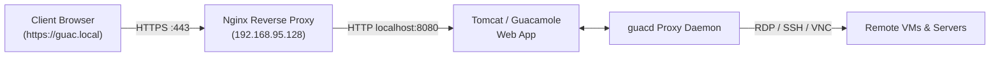

If you have set up **Apache Guacamole** on Red Hat Enterprise Linux (RHEL) 9.8, you probably access it by typing something like `http://192.168.95.128:8080/guacamole` into your browser. While functional, remembering IP addresses and port numbers isn't ideal—and running unencrypted HTTP over your network isn't great for remote desktop sessions.

In this guide, we will configure **Nginx** as a reverse proxy on RHEL 9.8 with SSL/TLS termination so you can simply navigate to `https://guac.local` and jump straight into your Guacamole dashboard.

---

## Architecture Overview

Instead of exposing Apache Tomcat (port `8080`) directly to your client devices, Nginx will sit in front of it on standard web ports (`80` and `443`), handle HTTPS encryption, and forward traffic internally to Guacamole over `localhost`.



> If you saved the architecture diagram image, place it in your blog's `/assets/img/` folder and uncomment the `image:` section in the front matter at the top of this file!
{: .prompt-tip }

---

## Prerequisites

Before getting started, ensure you have:
- A server running **RHEL 9.8** (Static IP: `192.168.95.128`).
- **Apache Guacamole** and **Tomcat** already installed and running on `http://localhost:8080/guacamole`.
- `sudo` or `root` privileges on the server.

---

## Step 1: Map `guac.local` to Your Server IP

For your browser to know that `guac.local` lives at `192.168.95.128`, you need to configure local name resolution.

### Option A: Using a Local DNS Server (Recommended)
If you run Pi-hole, AdGuard Home, Windows DNS, or a router with custom DNS entries, add an **A Record**:
- **Domain:** `guac.local`
- **IP Address:** `192.168.95.128`

### Option B: Using Your Client's `hosts` File
If you don't have a local DNS server, add the entry directly to the `hosts` file on the computer you are browsing from:

- **Linux / macOS (`/etc/hosts`):**
  ```bash
  echo "192.168.95.128 guac.local" | sudo tee -a /etc/hosts
  ```
- **Windows (`C:\Windows\System32\drivers\etc\hosts`):**
  Open Notepad as Administrator and append:
  ```text
  192.168.95.128 guac.local
  ```

---

## Step 2: Install and Enable Nginx on RHEL 9.8

Install Nginx from the official RHEL AppStream repository and enable it to start automatically on boot:

```bash
sudo dnf install nginx -y
sudo systemctl enable --now nginx
```

Verify that Nginx is active and running:

```bash
sudo systemctl status nginx
```

---

## Step 3: Generate a Self-Signed SSL Certificate

Since `guac.local` is a private local domain, we can generate a self-signed TLS certificate using OpenSSL with a Subject Alternative Name (SAN) so modern browsers recognize the domain properly:

```bash
sudo openssl req -x509 -nodes -days 365 -newkey rsa:2048 \
  -keyout /etc/pki/tls/private/guac.local.key \
  -out /etc/pki/tls/certs/guac.local.crt \
  -subj "/CN=guac.local" \
  -addext "subjectAltName=DNS:guac.local"
```

Secure the private key permissions:

```bash
sudo chmod 600 /etc/pki/tls/private/guac.local.key
```

---

## Step 4: Configure Nginx as a Reverse Proxy

Create a dedicated server block configuration file for Guacamole:

```bash
sudo nano /etc/nginx/conf.d/guacamole.conf
```

Paste the following configuration:

```nginx
# Redirect all HTTP traffic to HTTPS
server {
    listen 80;
    server_name guac.local;
    return 301 https://$host$request_uri;
}

# HTTPS Reverse Proxy for Apache Guacamole
server {
    listen 443 ssl;
    server_name guac.local;

    ssl_certificate /etc/pki/tls/certs/guac.local.crt;
    ssl_certificate_key /etc/pki/tls/private/guac.local.key;

    ssl_protocols TLSv1.2 TLSv1.3;
    ssl_ciphers HIGH:!aNULL:!MD5;

    # Allow large file uploads over RDP/SFTP drive redirection
    client_max_body_size 100m;

    location / {
        proxy_pass http://127.0.0.1:8080/guacamole/;
        proxy_buffering off;
        proxy_http_version 1.1;
        proxy_set_header X-Forwarded-For $proxy_add_x_forwarded_for;
        proxy_set_header Upgrade $http_upgrade;
        proxy_set_header Connection $http_connection;
        proxy_cookie_path /guacamole/ /;
        access_log off;
    }
}
```

> **Why are `proxy_buffering off` and `Upgrade` headers required?**
> Apache Guacamole relies heavily on WebSockets for real-time screen streaming and keyboard/mouse input. Disabling proxy buffering prevents Nginx from holding onto packets, eliminating input lag during remote desktop sessions.
{: .prompt-info }

Test your Nginx configuration for syntax errors and reload the service:

```bash
sudo nginx -t
sudo systemctl reload nginx
```

---

## Step 5: Configure SELinux and Firewalld

On RHEL 9.8, **SELinux** blocks Nginx from initiating outbound network connections to backend ports like `8080` by default. If you skip this step, you will encounter a `502 Bad Gateway` error.

Allow Nginx to connect to local network services:

```bash
sudo setsebool -P httpd_can_network_connect 1
```

Next, allow HTTP and HTTPS traffic through `firewalld` (and optionally remove public access to port `8080` if you previously opened it):

```bash
sudo firewall-cmd --permanent --add-service=http
sudo firewall-cmd --permanent --add-service=https
sudo firewall-cmd --permanent --remove-port=8080/tcp
sudo firewall-cmd --reload
```

> Removing port `8080/tcp` from `firewalld` ensures users can no longer bypass Nginx to hit Tomcat directly, while Nginx can still reach Tomcat internally over `127.0.0.1:8080`.
{: .prompt-warning }

---

## Step 6: Verify the Setup

Open your browser and navigate to:

```text
https://guac.local
```

1. Because we used a self-signed certificate, click **Advanced** $\rightarrow$ **Proceed to guac.local (unsafe)** on the browser warning screen.
2. You should immediately see the **Apache Guacamole** login screen—without needing to type `:8080` or `/guacamole`!

---

## Conclusion

By placing Nginx in front of Tomcat on RHEL 9.8, you now have a cleaner URL (`https://guac.local`), encrypted traffic over HTTPS, and properly configured WebSocket proxying while adhering to RHEL's SELinux and `firewalld` security standards.