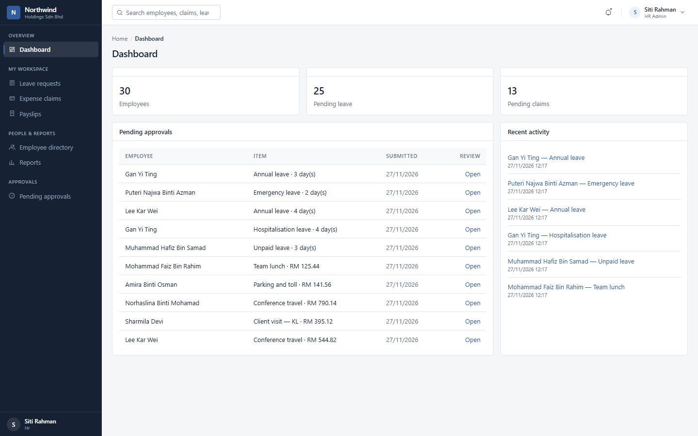
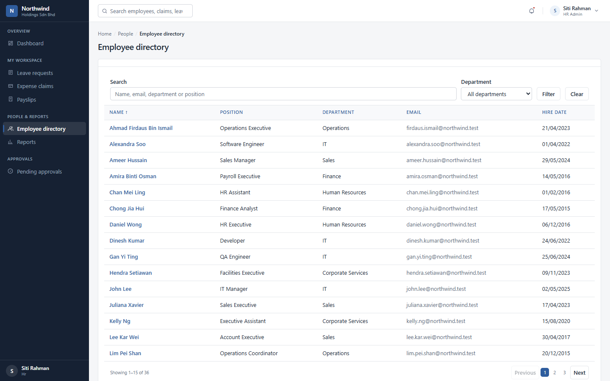
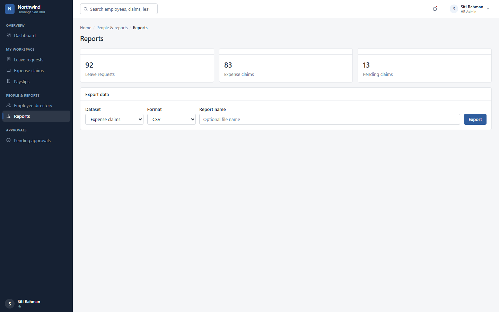

I wanted a place to practise finding and exploiting web vulnerabilities without staring at another abstract lab. Something with a real UI, realistic data, and enough moving parts that the bugs feel like they belong to an actual app. So I built a small HR portal, then deliberately broke eleven things in it.

This is the story of what I built and why.

## Why I built it

Most training targets are either too synthetic (a single form, one obvious flaw) or too heavy (a full VM you have to babysit). I wanted something in the middle: a normal-looking HR system with dashboards, leave requests, claims, payslips, a staff directory, and an API — where the flaws are spread across the app the way they'd show up in real code.

Everything runs locally on `127.0.0.1`. The data is entirely fake — a fictional company called Northwind Holdings Sdn Bhd, Malaysian names, `RM` amounts, dates in `DD/MM/YYYY`, and `@northwind.test` email addresses. Nobody's real information is anywhere in it.

## The stack

I kept it deliberately boring so the focus stays on the security lessons:

- **Laravel 12** on **PHP 8.3** — the app itself
- **MySQL 8** locally — the database
- **Tailwind CSS v4** — styling, driven by an `@theme` block
- **Laravel Sanctum** — tokens for the JSON API
- **Blade components** — a reusable UI kit so every page looks consistent
- **PHPUnit** — a small feature suite to catch regressions

There's no Docker or Nginx in the mix. Just `php artisan serve` and a local MySQL instance.

## A quick tour

### The dashboard

The first thing you see after logging in is the dashboard. It gives you workforce counts at a glance and a live list of pending approvals — leave requests and expense claims waiting on a manager.

It looks like a perfectly ordinary internal tool. That's kind of the point. The vulnerabilities aren't in some hidden admin panel; they're in the everyday flows you'd click through without thinking twice.

### The employee directory

The directory is the most data-dense screen in the app. Search by name, filter by department, sort by column — 37 seeded employee records with positions, departments, and contact details.

This page is also where one of the more interesting flaws lives: the search and sort parameters get spliced into SQL text without binding. It's a good reminder that "just a search box" is a perfectly respectable injection surface.

### Reports and exports

HR users get a reporting screen with aggregate counts and CSV/PDF export.

Between this page and the API, there are a couple of authorization gaps worth finding — the kind where a logged-in user is legitimate but never actually checked against the data they're asking for.

### The bugs themselves

I documented each of the eleven flaws in its own folder under `docs/vulnerabilities/`. Each one covers what the mistake is, how someone would think about exploiting it conceptually, why it matters, and how to fix it. No copy-paste exploit scripts — just enough detail to understand the technique.

The set includes the classics (SQL injection, stored XSS, IDOR, command injection, SSRF, unrestricted upload), auth problems (weak password reset, broken API authorization, plaintext password storage), and plain old information exposure through a public backup file and debug mode.

## Things I learned along the way

**A "harmless" accessibility change can break more than you expect.** When I refactored the UI into reusable components, the `<x-card header="...">` attribute wasn't declared on the component class. Blade happily passed it through as a raw HTML attribute, so none of the card headers were rendering. The pages still returned 200, which is exactly why I now check the rendered HTML and not just the status code.

**Tests that touch a shared database will bite you.** My first feature suite pointed at the same local MySQL instance I was developing against. Running the tests reseeded the DB right in the middle of a manual check. I moved the suite to SQLite in-memory so tests stay self-contained and never clobber local data.

**CI is worth it even for a toy project.** The GitHub Actions workflow runs the build, a style check, and the feature tests on every push. It caught regressions I'd otherwise have found by accident.

## Wrapping up

This has been a fun one to build. It's small enough to understand end to end, but messy enough to be a useful practice target. If you want to poke around:

- GitHub repo: `[https://github.com/amirqusairy99/vulnerable-hr-portal]`

And the usual disclaimer, because it matters: this is intentionally vulnerable, runs locally only, contains fake data, and should never be deployed to the internet or a shared network. Don't enter a real password anywhere in it.
