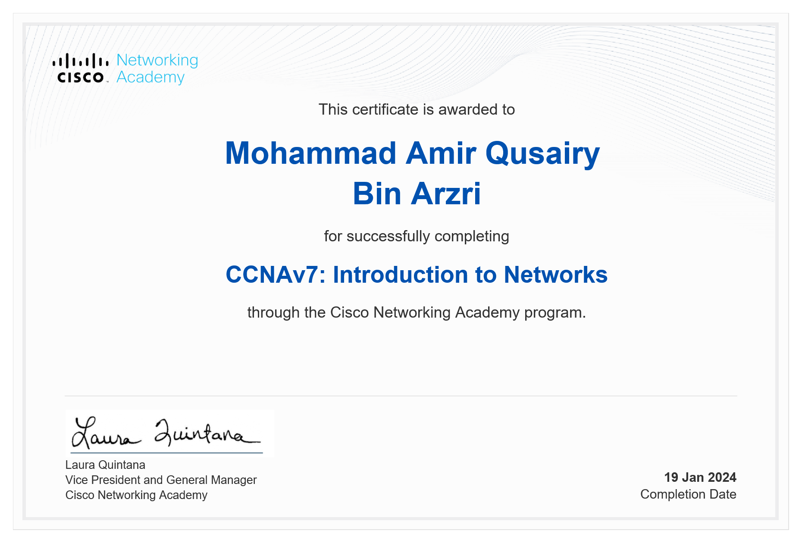
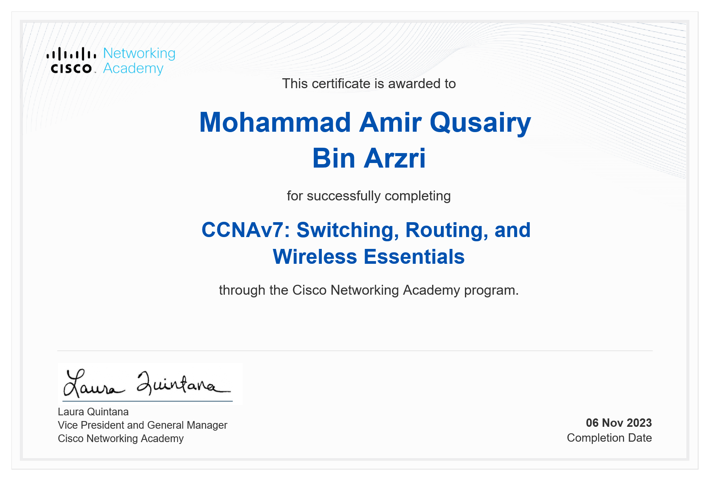
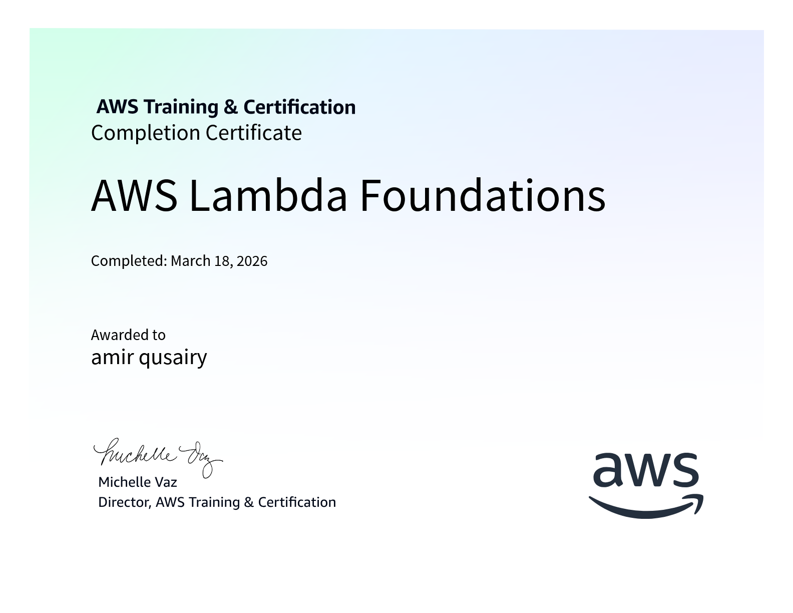
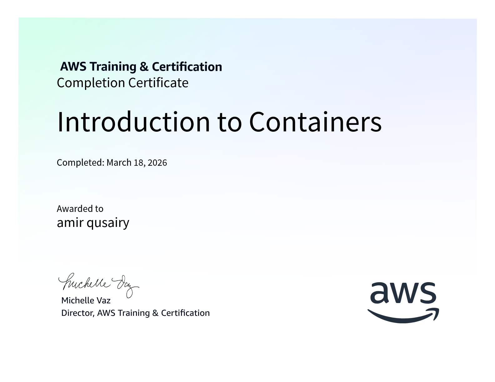
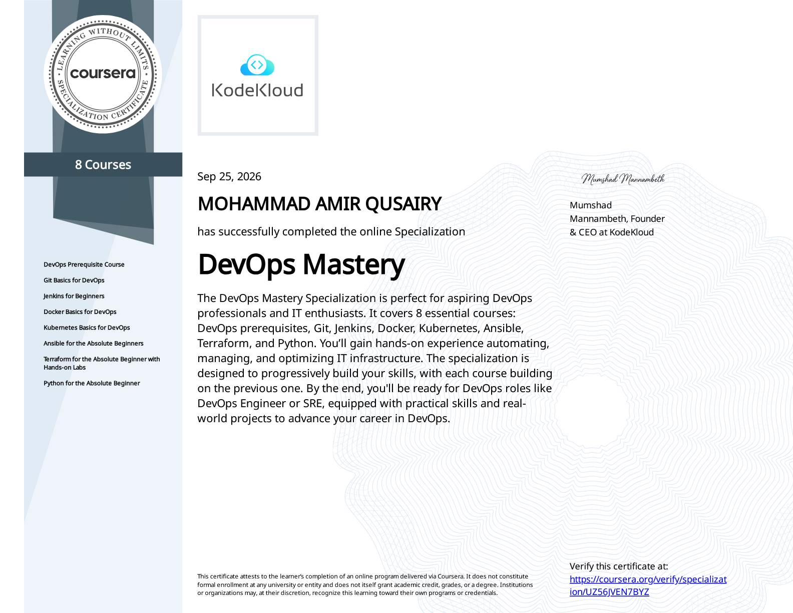

  
  <!-- Cisco Section -->
  

    
    Cisco NDG Linux Essentials
  

  

    
    Cisco Network Security
  

  

    
    Cisco Introduction To Networks
  

  

    
    Cisco Switching and Routing
  

  <!-- AWS & Containers Section -->
  

    
    AWS Fargate Foundational
  

  

    
    AWS Lambda Foundations
  

  

    
    Introduction To Containers
  

  

    
    Docker Basics for DevOps
  

  

    
    Kubernetes Basics for DevOps
  

  <!-- Automation & DevOps Section -->
  

    
    Ansible for the Absolute Beginner
  

  

    
    Terraform for the Absolute Beginner
  

  

    
    Jenkins for Beginners
  

  

    
    Git Basics for DevOps
  

  

    
    Python for the Absolute Beginner
  

  

    
    DevOps Mastery
  

  

    
    DevOps Prerequisite Course
  

