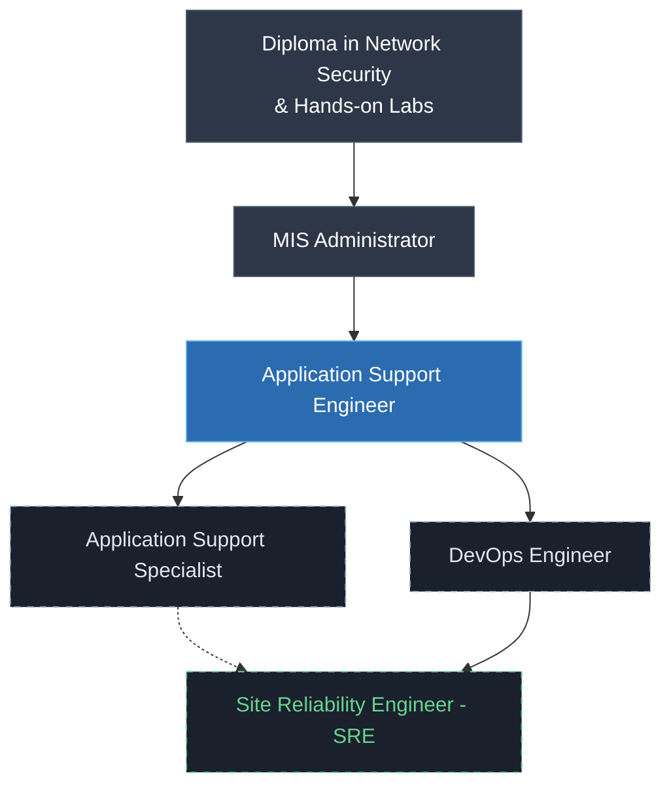

## Career Progression

> **Note:** Solid boxes represent completed or active milestones. Dashed boxes represent target paths.
{: .prompt-info }

---

## Technical Skills

### Operating Systems & System Administration
* **Linux:** Red Hat Enterprise Linux (RHEL), CentOS/Rocky Linux, Ubuntu Server
* **Windows:** Windows Server, Active Directory (AD), Group Policy (GPO), IIS
* **Core Admin:** User/permission management, patching, backup & recovery, virtualization (VMware / Hyper-V)

### Networking & Infrastructure
* **Core Services:** DNS, DHCP, TCP/IP, Subnetting, VLANs
* **Security:** Firewalls, VPNs, SSH hardening, SSL/TLS certificates

### Application Support & Troubleshooting
* **Diagnostics:** Log analysis, root cause analysis (RCA), incident management (ITIL)
* **Databases & Web:** Basic SQL querying, web server administration (IIS / Apache / Nginx), API troubleshooting

### Target Skills (DevOps & SRE Track)
* **Scripting & Automation:** Bash, PowerShell, Python, Ansible
* **Containers & Cloud:** Docker, Kubernetes, AWS / Azure fundamentals
* **Observability & CI/CD:** Git, GitHub Actions / Jenkins, Prometheus, Grafana