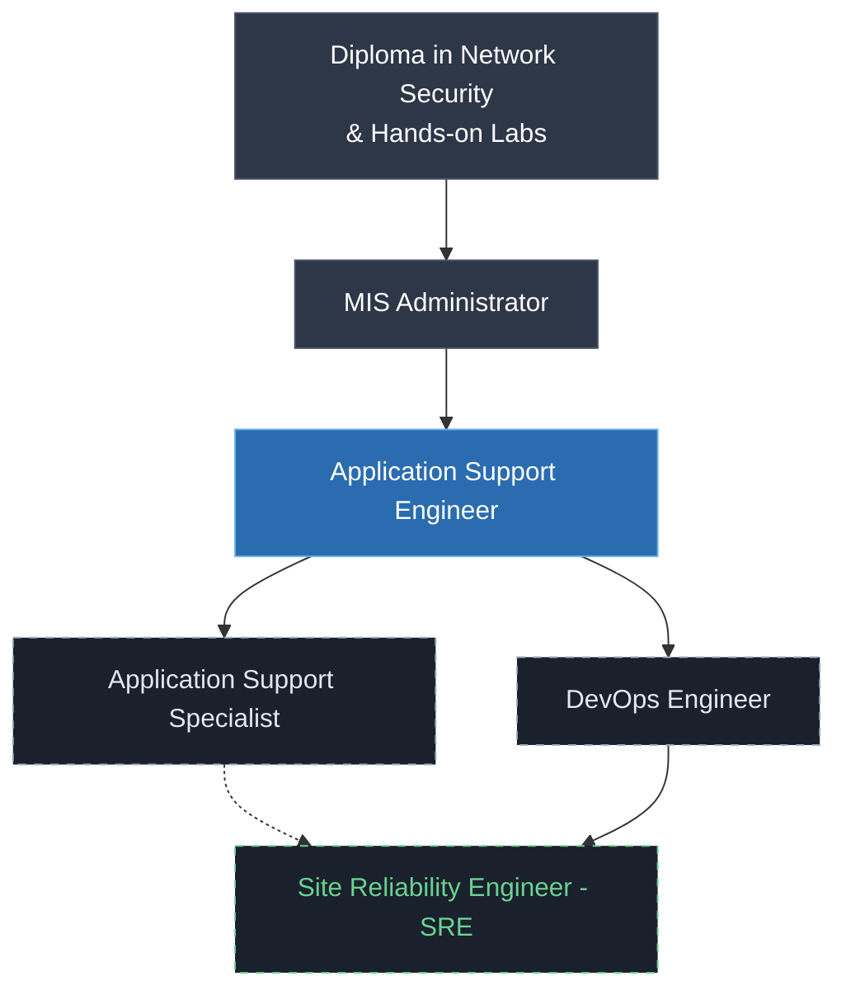

## Career Progression

> **Note:** Solid boxes represent completed or active milestones. Dashed boxes represent target paths.
{: .prompt-info }

---

## Technical Skills

  

    <h4><i class="fas fa-server"></i> OS &amp; System Admin</h4>
    

      
      
      
      
      
      
      
      
      
    

  

  

    <h4><i class="fas fa-network-wired"></i> Networking &amp; Security</h4>
    

      
      
      
      
      
      
      
      
    

  

  

    <h4><i class="fas fa-tools"></i> App Support &amp; Ops</h4>
    

      
      
      
      
      
      
      
    

  

  

    <h4><i class="fas fa-rocket"></i> Target: DevOps &amp; SRE</h4>
    

      
      
      
      
      
      
      
      
      
      
      
    

  

